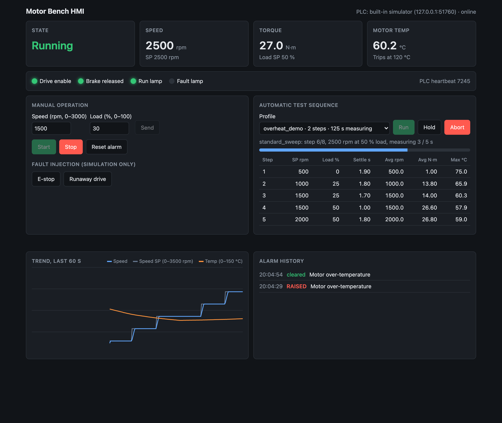

# モーター試験ベンチ HMI

PCアプリ (C# / WinForms) から Modbus TCP 経由で PLC を操作し、モーター試験ベンチの
手動運転・自動試験・トレンド表示・データ記録を行うソフトウェアです。

PCベースの計測・制御ソフトとPLCの連携を学ぶための自己学習プロジェクトです。
試験ベンチ本体はPLCプログラム内でシミュレーションしているため、実機なしで1台のPCで動作します。

[English README](README.md)



## コマンド1つで試す

Windows / macOS / Linux、[.NET 10 SDK](https://dotnet.microsoft.com/download) があれば動きます。

```
dotnet run --project src/MotorBench.Web
```

ブラウザで <http://localhost:5080> を開き、`standard_sweep` を選んで **Run** を押します。
Web HMI は内蔵のPLCシミュレーターを起動し、実際の Modbus TCP 通信で接続します。
試験中に **E-stop** を押す、または `overheat_demo` を実行すると、PLCがアラームで
ベンチを停止し、自動試験が中止される様子を確認できます。

## 機能

- **手動運転**: 速度指令・負荷指令の設定、運転 / 停止 / リセット
- **自動試験**: CSVの試験パターンに沿ってステップごとに実行。速度の整定を待ってから
  指定時間計測し、平均速度・平均トルク・最高温度を記録。一時停止 / 再開 / 中止に対応
- **安全関係はPLC側で処理**: 非常停止、過速度、モーター過温度、HMI通信異常 (ウォッチドッグ)。
  アラームはファーストアウト方式で保持。PCが停止してもPLCが2秒以内にベンチを停止
- **トレンド表示** (直近60秒)、計測データ・試験結果・アラーム履歴のCSV保存
- **Modbus TCP 通信部は自作** (FC01, FC03, FC06, FC16)
- **HMIは2種類、共通ライブラリ1つ**: WinForms デスクトップ版と、どのOSでも動く Web 版

## 構成

```
 +---------------------------+       Modbus TCP :502       +----------------------------+
 |  MotorBench.App (WinForms)| <-------------------------> |  OpenPLC Runtime           |
 |  HMI・自動試験・記録       |                             |  plc/bench_control.st      |
 +---------------------------+                             +----------------------------+
```

MotorBench.Sim は同じレジスタマップをC#で再現したシミュレーターで、OpenPLCなしでHMIを開発・確認できます。

レジスタマップ、状態遷移、アラーム、タイミングの詳細: [docs/design.md](docs/design.md)

## フォルダ構成

```
plc/bench_control.st        OpenPLC Runtime 用 PLCプログラム (ST)
plc/LADDER.md               同じロジックのラダー版 (OpenPLC Editor)
src/MotorBench.Core         Modbus TCP、PLC接続、自動試験、記録
src/MotorBench.App          WinForms HMI (Windows)
src/MotorBench.Web          Web HMI + 内蔵シミュレーター (全OS)
src/MotorBench.Sim          PLCシミュレーター (コンソール)
tests/MotorBench.Tests      xUnit テスト
profiles/                   試験パターン例
docs/design.md              設計メモ
```

## 動かし方

.NET 10 SDK (Visual Studio 2026 または `dotnet` コマンド) が必要です。
Web HMI は全OSで、WinForms HMI は Windows 10/11 で動作します。

### Web HMI

```
dotnet run --project src/MotorBench.Web                              # 内蔵シミュレーター
dotnet run --project src/MotorBench.Web -- --plc-host 192.168.0.10   # OpenPLC (ポート502)
```

`http://localhost:5080` のみで待ち受けます (モーターを起動できる画面のため)。
試験結果とアラーム履歴は `src/MotorBench.Web/data/` に保存されます (`--data-dir` で変更可)。

### シミュレーターで動かす

```
dotnet run --project src/MotorBench.Sim
dotnet run --project src/MotorBench.App
```

HMIでホスト `127.0.0.1`、ポート `502` を指定して「接続」を押します。

### OpenPLC で動かす

1. OpenPLC Runtime v3 をインストールし、Web画面を開く
2. Programs から `plc/bench_control.st` をアップロードしてコンパイル
3. Modbus サーバーが有効 (ポート502) であることを確認し、Start PLC
4. HMIでランタイムのIPアドレスとポート502を指定して接続

レジスタマップは OpenPLC の標準設定 (%QW0 → HR 0、%MW0 → HR 1024) を前提としています。

## 試験パターン

```
# コメント
speed_rpm,load_pct,dwell_s
500,0,5
1500,50,10
```

`profiles/overheat_demo.csv` は過温度アラームが発生するまで全負荷で運転し、
自動試験中にアラームが発生したときの動作を確認するためのパターンです。

## 保存ファイル

`ドキュメント\MotorBench` に保存されます。

| ファイル                      | 内容                               |
|------------------------------|------------------------------------|
| `manual_*.csv`, `seq_*.csv`  | 運転中の計測データ (100 ms ごと)     |
| `result_<パターン名>_*.csv`   | 自動試験のステップごとの結果         |
| `alarm_history.csv`          | アラームの発生・解除履歴             |

## テスト

```
dotnet test
```

Modbusフレーム、クライアント/サーバー通信とタイムアウト、PLCロジック (運転・停止、非常停止、
ウォッチドッグ、過温度とリセットのヒステリシス、ファーストアウト)、試験パターンの読込、
自動試験、TCP経由の結合テストを含みます。

## 実機に置き換える場合

- `BenchSim` を実I/Oに置き換える: インバーターへの速度指令、ドライブ・トルク計・温度センサーからの実測値
- 非常停止はハード配線の安全回路で処理し、PLCは入力として読むだけにする (Modbusでは扱わない)
- 三菱PLCの場合は、PC側の通信は Modbus より MCプロトコル (SLMP) が一般的
