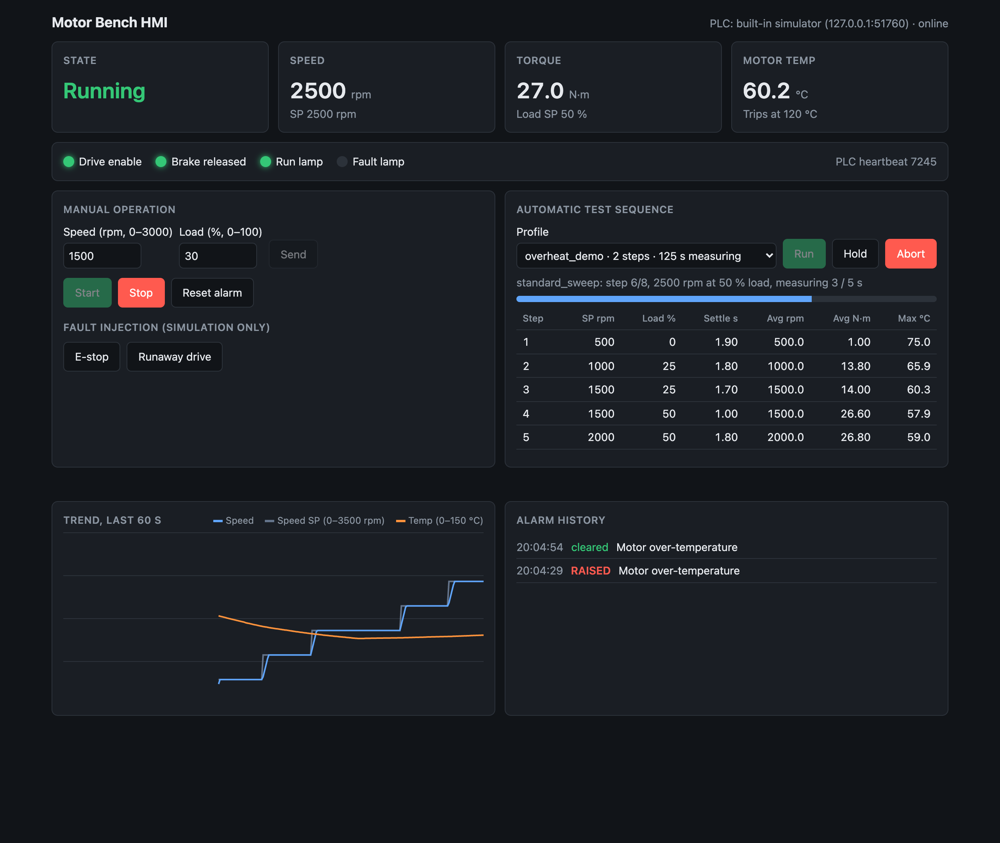

# Motor Bench HMI

A PC application that runs a motor test bench through a PLC over Modbus TCP:
manual operation, automatic test sequences, trend display and data logging.

Built as a self-study project to learn how PC-based measurement and control
software talks to PLCs. The bench itself is simulated inside the PLC program,
so everything runs on one PC without hardware.

[日本語版 README](README.ja.md)



## Try it in one command

Any OS (Windows, macOS, Linux) with the [.NET 10 SDK](https://dotnet.microsoft.com/download):

```
dotnet run --project src/MotorBench.Web
```

Open <http://localhost:5080>, pick `standard_sweep` and press **Run**. The web HMI
starts its own simulated PLC and talks to it over a real Modbus TCP socket.
Try **E-stop** mid-run, or the `overheat_demo` profile, to watch the PLC trip
an alarm and abort the sequence.

## What it does

- **Manual operation**: speed and load setpoints, start / stop / reset
- **Auto test**: runs a CSV test profile step by step. Each step waits for the
  speed to settle, measures for a set time, stores average speed, average
  torque and max temperature. Hold / resume / abort.
- **Safety in the PLC**: E-stop, overspeed, motor over-temperature and an HMI
  watchdog, latched first-out. If the PC crashes, the PLC stops the bench by
  itself within 2 s.
- **Trend** of the last 60 s, CSV logging of measurements, step results and
  alarm history
- **Own Modbus TCP client and server** (FC01, FC03, FC06, FC16), no library
- **Two HMIs on one core library**: the WinForms desktop app, and a web HMI
  that runs anywhere

## Engineering decisions worth a look

- **The PC is never trusted with safety.** Start permission, alarm stops and
  the watchdog all live in the PLC program. Kill the HMI process while the
  motor runs and the PLC faults the bench within 2 s.
- **One command register with a handshake** instead of a coil per button: the
  PLC clears it when taken, so a command runs exactly once and start/stop can
  never be active together. The HMI confirms the PLC took it within 500 ms.
- **First-out alarm latching with reset conditions** (e.g. over-temperature
  only resets below 110 °C, and never while the motor turns).
- **Status registers are copied out at end of scan**, never used as PLC memory,
  because OpenPLC lets any Modbus client write %QW.
- **The sequencer has no timer of its own.** It is driven by status
  timestamps, so it is unit-tested without sleeping and can't skip a step when
  the poll loop stalls.
- **The Modbus client drops the connection on a timeout**, so a late reply can
  never be read as the answer to the next request.
- **The HMI checks which PLC program it is talking to** (register map version
  in %QW8) before its first write, so a new HMI never pokes commands into an
  old program whose registers mean something else.

## Architecture

```
 +---------------------------+       Modbus TCP :502       +----------------------------+
 |  MotorBench.App (WinForms)| <-------------------------> |  OpenPLC Runtime           |
 |  HMI, sequencer, logging  |                             |  plc/bench_control.st      |
 +---------------------------+                             +----------------------------+

 +---------------------------+
 |  MotorBench.Web (browser) | <----- same Modbus TCP path, same Core library
 |  ASP.NET minimal API      |
 +---------------------------+

 MotorBench.Sim serves the same register map from C#, for working on the HMI
 without OpenPLC. MotorBench.Web hosts it in-process when no PLC address is given.
```

Details (register map, state machine, alarms, timing): [docs/design.md](docs/design.md)

## Repository layout

```
plc/bench_control.st        PLC program (Structured Text) for OpenPLC Runtime
plc/LADDER.md               the same logic as ladder rungs for OpenPLC Editor
src/MotorBench.Core         Modbus TCP, PLC wrapper, sequencer, logging
src/MotorBench.App          WinForms HMI (Windows)
src/MotorBench.Web          web HMI + built-in simulator (any OS)
src/MotorBench.Sim          PLC simulator (console)
tests/MotorBench.Tests      xUnit tests
profiles/                   example test profiles
docs/design.md              design notes
docs/web-hmi.md, deploy.md   web HMI settings and security; installing as a service
deploy/motorbench.service   systemd unit
```

## Running it

Requires the .NET 10 SDK (Visual Studio 2026 or the `dotnet` CLI). The web HMI
runs on any OS; the WinForms HMI needs Windows 10/11.

### Web HMI

```
dotnet run --project src/MotorBench.Web                                  # built-in simulator
dotnet run --project src/MotorBench.Web -- --plc-host 192.168.0.10       # OpenPLC, port 502
dotnet run --project src/MotorBench.Web -- --plc-host 127.0.0.1 --plc-port 5020
```

It listens on `http://localhost:5080` only, since the page can start a motor.
Step reports, the alarm history and the audit log go to `src/MotorBench.Web/data/`
(change with `--data-dir`).

With no users configured it runs in local mode (no login, this machine only).
Add users to get logins with Viewer / Operator / Engineer roles, a one-tab
control lock, and HTTPS access from other PCs. Settings, roles, the audit log and
the API: [docs/web-hmi.md](docs/web-hmi.md).

Releases are self-contained binaries for Windows and Linux that run as a Windows
service or under systemd, with `/healthz` and `/readyz` for monitoring. The HMI
checks the PLC program's register map version before it writes anything. See
[docs/deploy.md](docs/deploy.md).

### WinForms HMI with the simulator

```
dotnet run --project src/MotorBench.Sim
dotnet run --project src/MotorBench.App
```

Click 接続 (connect) with host `127.0.0.1`, port `502`. On macOS/Linux ports
below 1024 need root, so run the simulator with a port argument, e.g.
`dotnet run --project src/MotorBench.Sim -- 5020`.

### With OpenPLC

1. Install OpenPLC Runtime v3 and open its web page.
2. Programs → upload `plc/bench_control.st` and compile it.
3. Make sure the Modbus server is enabled (port 502), then Start PLC.
4. Start the HMI and connect to the runtime's IP address, port 502.

The register map assumes OpenPLC's default mapping (%QW0 → HR 0,
%MW0 → HR 1024).

## Test profiles

```
# comment
speed_rpm,load_pct,dwell_s
500,0,5
1500,50,10
```

`profiles/overheat_demo.csv` runs at full load until the over-temperature alarm
trips, to show what happens when a bench alarm interrupts a sequence.

## Data files

The WinForms HMI writes to `Documents\MotorBench`:

| File                         | Content                               |
|------------------------------|---------------------------------------|
| `manual_*.csv`, `seq_*.csv`  | one row per poll (100 ms) while running |
| `result_<profile>_*.csv`     | step results of a sequence run        |
| `alarm_history.csv`          | alarms raised / cleared               |

## Tests

```
dotnet test
```

Covers Modbus framing, client/server round trips and timeouts, the PLC logic
(start/stop, E-stop, watchdog, over-temperature with reset hysteresis,
first-out), profile parsing, the sequencer, an end-to-end run over TCP, and the
web HMI running a full test profile through its HTTP API, plus the web HMI's
security, traceability, shutdown and PLC-version checks.

On every push, CI builds all projects (warnings as errors, WinForms included),
checks formatting (`dotnet format --verify-no-changes`), runs the tests and
posts line/branch coverage to the job summary. CodeQL scans the C#, the page
scripts and the workflows weekly and on every pull request. Dependabot proposes
NuGet and Actions updates weekly.

## On real hardware

- `BenchSim` would be replaced by real I/O: speed setpoint to the inverter,
  speed / torque / temperature from the drive, torque meter and sensors.
- The E-stop belongs in a hard-wired safety circuit. The PLC only reads it as
  an input; it is never a Modbus register.
- Many Japanese machines use Mitsubishi PLCs, where the PC side would more
  likely use the MC protocol (SLMP) than Modbus.
